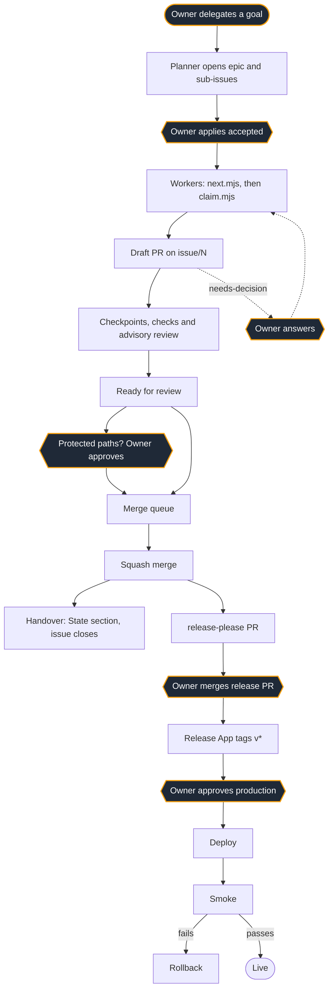

# Workflow

The flow for humans. Rules and contracts live in [spec.md](spec.md); this page shows where you step in.

## Lifecycle

Owner gates are the dark boxes.

## The worker scripts

A worker session runs these as `node scripts/agent/<name>.mjs` on Node 24+. Everything that writes goes through `node scripts/agent/token.mjs exec -- `, so GitHub sees the agent App and never your login.

| Step | Command | Does |
|---|---|---|
| Pick | `next` | Next ready task or takeover candidate, with the reason for every skipped one |
| Take | `claim N --session <id> --agent <model>/<harness>` | Claim commit, `issue/N`, pointer comment, draft PR; or a takeover of an expired or released draft |
| Brief | `resume N --session <id>` | Bounded briefing for a takeover or a revived worker; no writes |
| Save | `checkpoint --session <id>` | Push, rewrite the PR `## State`, post the journal comment. The `Stop` and `PreCompact` hooks run `checkpoint --auto`, which pushes, and also rewrites State and posts the journal when `.artifacts/checkpoint.json` exists |
| Hand back | `release N --decision --session <id>` | Draft again, released marker; for a `needs-decision` |
| Close out | `release N --merged --session <id>` | Handover comment on the issue after the merge |

Marking ready and enqueueing (`gh pr ready`, `gh pr merge N --auto --squash`) also run through the wrapper. The session id is the harness session id, so the hooks match the PR footer. Subagents share their parent's id and fire no hooks; parallel workers are separate top-level sessions. Exit 3 from `resume`, `checkpoint` or `release --decision` means the PR footer names another session: stop. Exit 3 from `claim` means held or not ready: run `next` again. Details in [6.3, 6.4](spec.md) and [13](spec.md).

Planner and reviewer sessions use two more scripts, driven by the `groundwork-planner` and `groundwork-reviewer` skills:

| Role | Command | Does |
|---|---|---|
| Planner | `plan-lint N [--post]` | Lints the epic's plan and prints lane width; `--post` creates or updates the one report comment. `plan-lint.yml` posts it on epic events too |
| Planner | `plan-lint N --close` | Checks the epic against the close list (4.5) before you close it; writes nothing |
| Reviewer | `review-queue` | Ready PRs with no review from the agent account on the current head, and Dependabot PRs. A review counts with a `Reviewer:` line first or last, on the current head. It does not exclude your own session |

Sections: planning [6.2](spec.md), worker loop [6.3](spec.md), PR contract [7](spec.md), CI [8](spec.md), rulesets [9](spec.md), releases [11](spec.md).

## Your touchpoints

- Accept epics: apply the `accepted` label once the plan reads right. Nothing is built before this.
- Answer `needs-decision` issues. The agent stops and waits (6.6).
- Approve PRs that touch protected paths (CODEOWNERS, 9.4).
- Approve admin runs in the browser or the GitHub mobile app (section 12).
- Merge release PRs (section 11). They touch the manifest, so they need your approval too.
- Approve each production deploy (the `production` environment, 10.1).

Everything else merges on green checks through the queue.

## Your inbox

`node scripts/agent/token.mjs exec -- node scripts/human/inbox.mjs` lists what waits for you: epics to accept, `needs-decision` issues, PRs on protected paths awaiting your approval, the release PR, pending `production` and `admin` approvals, alert issues, orphaned claims. `--json` prints the sections. A section the App cannot read prints `unreadable` (403 or 404). It prints links; you act in the browser.

## Admin tiers

| Tier | Scope | Your action |
|---|---|---|
| 0 | Normal work, agent App | none |
| 1 | Settings as code (`settings.json`, `labels.json`, `rulesets/*.json`) | Approve the PR, then the `admin` run |
| 2 | One-off ops: `bootstrap`, `bootstrap-pass2`, issue types, cleanup | Read the run summary, approve the `admin` run. The run name carries op, target and args; `check` runs at the end of each bootstrap |
| 3 | Apps, billing, org ownership, secret values, PAT rotation | You, in the browser |

Detail in [section 12](spec.md).

## What agents never do

Force-push or rebase, push to `main`, bypass checks, change rulesets or secrets, or merge their own protected-path changes. The full list is in [AGENTS.md](../AGENTS.md); the enforcement is in [sections 9 and 17](spec.md).
