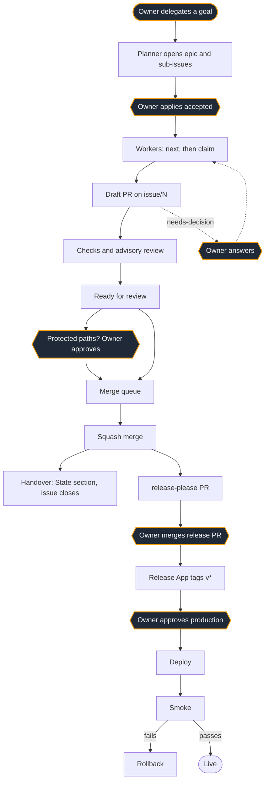

# Workflow

The flow for humans. Rules and contracts live in [spec.md](spec.md); this page shows where you step in.

## Lifecycle

Owner gates are the dark boxes.

Sections: planning [6.2](spec.md), worker loop [6.3](spec.md), PR contract [7](spec.md), CI [8](spec.md), rulesets [9](spec.md), releases [11](spec.md).

## Your touchpoints

- Accept epics: apply the `accepted` label once the plan reads right. Nothing is built before this.
- Answer `needs-decision` issues. The agent stops and waits (6.6).
- Approve PRs that touch protected paths (CODEOWNERS, 9.4).
- Approve admin runs in the browser or the GitHub mobile app (section 12).
- Merge release PRs (section 11). They touch the manifest, so they need your approval too.
- Approve each production deploy (the `production` environment, 10.1).

Everything else merges on green checks through the queue.

## Your inbox

`scripts/human/inbox` lists what waits for you: epics to accept, `needs-decision` issues, PRs on protected paths, release PRs, alert issues. Arrives in Phase 3.

## Admin tiers

| Tier | Scope | Your action |
|---|---|---|
| 0 | Normal work, agent App | none |
| 1 | Settings as code (`settings.json`, `labels.json`, `rulesets/*.json`) | Approve the PR, then the `admin` run |
| 2 | One-off ops: bootstrap, new repo, issue types, cleanup | Read the run summary, approve the `admin` run |
| 3 | Apps, billing, org ownership, secret values, PAT rotation | You, in the browser |

Detail in [section 12](spec.md).

## What agents never do

Force-push or rebase, push to `main`, bypass checks, change rulesets or secrets, or merge their own protected-path changes. The full list is in [AGENTS.md](../AGENTS.md); the enforcement is in [sections 9 and 17](spec.md).
